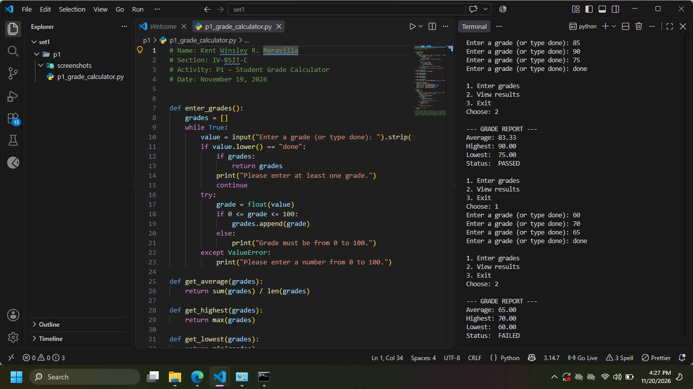
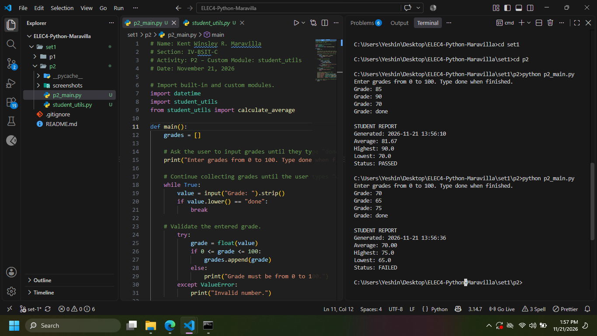
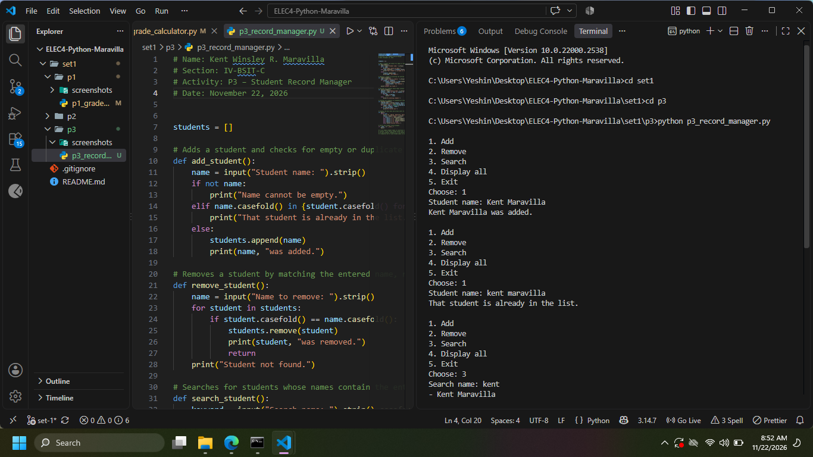
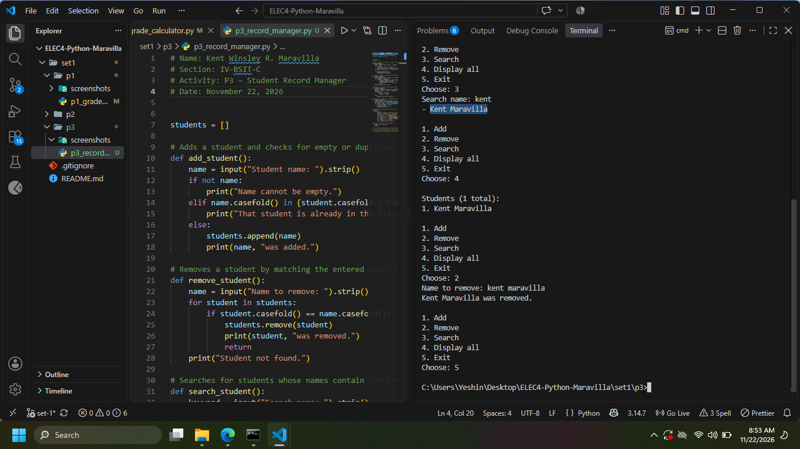
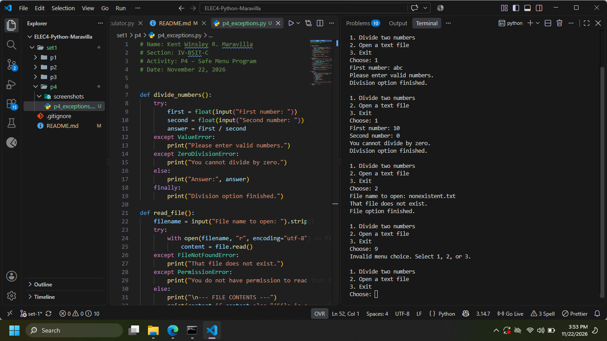

# ELEC4-Python-Maravilla

**ELEC 4 – Python Programming Activities**

- **Name:** Kent Winsley R. Maravilla
- **Section:** IV-BSIT-C
- **Course:** ELEC 4 – Python Programming

## Set 1 – Python Activities

| Activity | Description | Run |
|---|---|---|
| P1 | Student Grade Calculator | `python set1/p1/p1_grade_calculator.py` |
| P2 | Custom student utilities module | `python set1/p2/p2_main.py` |
| P3 | Student Record Manager | `python set1/p3/p3_record_manager.py` |
| P4 | Safe Menu / Exceptions | `python set1/p4/p4_exceptions.py` |

## Screenshots

### P1 – Student Grade Calculator

### P2 – Custom Module

### P3 – Student Record Manager

### P4 – Safe Menu Program

---

*This README will be updated as more activities are completed.*